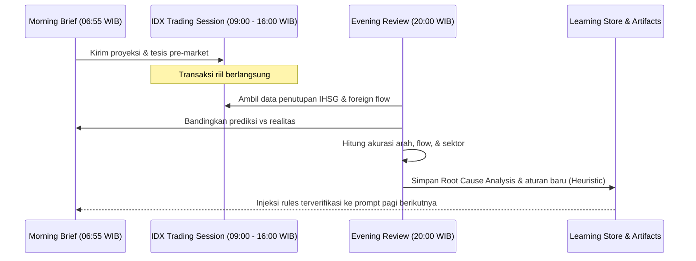

# Nexus System Architecture

Nexus adalah arsitektur multi-agen cerdas untuk intelijen pasar harian Indeks Harga Saham Gabungan (IHSG) Bursa Efek Indonesia (IDX). Sistem ini dirancang dengan prinsip pemisahan ketat antara **logika ekonomi deterministik** (hardcoded economics) dan **penalaran probabilistik LLM**, menjamin keandalan prediksi serta memitigasi halusinasi model.

---

## 1. High-Level System Architecture

```mermaid
flowchart TD
    subgraph Schedulers [Triggers & Automation]
        GHA[GitHub Actions Cloud]
        LocalCron[APScheduler / Windows Task]
        CLI[nexus CLI: brief / review]
    end

    subgraph CoreBoundary [Core Governance & Concurrency]
        Lock[core.locking: File Run Lock]
        TZ[core.time: Asia/Jakarta UTC+07:00]
        Cal[core.calendar: IDX Trading Calendar]
        SchedConfig[schedule.yaml: Single Source of Truth]
    end

    subgraph DataIngestion [Market Ingestion & Data Boundary]
        Tavily[Tavily News API + SHA256 Cache]
        YFinance[Yahoo Finance Provider]
        Licensed[Licensed Data Provider Mock/Stub]
        Boundary[Provider Licensing Boundary: NEXUS_PUBLIC_MODE]
    end

    subgraph ProcessingPipeline [Multi-Agent Analysis Pipeline]
        EconEngine[Deterministics: economics_engine.py]
        MarketAgent[market_agent.py: Pre-Market Thesis]
        ReviewAgent[evening_reviewer.py: Post-Market RCA]
        LLM[llm_client.py: OpenRouter / DeepInfra / Gemini]
        JSONParser[utils.json_parser: Multi-stage Repair]
        Validator[validator.py: Direction & Contradiction Fixer]
    end

    subgraph Persistence [Storage & Memory Loop]
        AtomicWrite[memory.artifacts: Atomic File IO]
        SQLite[memory.session: SQLite WAL Mode]
        Obsidian[memory.obsidian: Non-blocking Circuit Breaker]
        LearnStore[memory.learning_store: Heuristics & Rules]
    end

    subgraph Outbound [Delivery & Telemetry]
        Telegram[delivery.telegram: Safe HTML + Chunking]
        Dashboard[dashboard: Next.js 14 App Router + Middleware]
    end

    Schedulers --> CoreBoundary
    CoreBoundary --> DataIngestion
    DataIngestion --> ProcessingPipeline
    ProcessingPipeline --> Persistence
    Persistence --> Outbound
```



---

## 2. Deterministic vs Probabilistic Boundary

Salah satu keputusan arsitektural terpenting dalam Nexus adalah: **LLM tidak diperbolehkan menentukan dampak ekonomi secara liar.**

1. **Deterministic Economics Engine (`agents/economics_engine.py`)**:
   - Hubungan kausal komoditas ke sektor saham di-hardcode secara matematis dan logis.
   - Contoh: Kenaikan harga minyak sawit mentah (CPO) secara langsung memetakan dampak positif ke sektor `Agri / CPO` (seperti AALI, TAPG, LSIP), dan kenaikan harga batu bara ke sektor `Energy`.
   - Hal ini mencegah halusinasi model LLM yang dapat salah mengartikan arah transmisi harga komoditas global terhadap indeks sektoral domestik.

2. **Deterministic Mathematical Scoring (utils/direction.py & utils/flow.py)**:
   - Prediksi vs Aktual tidak dinilai oleh persepsi subjektif LLM.
   - Evaluasi arah IHSG menggunakan ambang batas pasti ±0.20% (dibawah nilai ini dikategorikan NEUTRAL).
   - Foreign flow dinilai menggunakan ambang batas materialitas ±Rp 1.0 Triliun dengan verifikasi tanggal D/M/Y ketat. Ketika scorable $n < 5$, aliran dana asing diperlakukan sebagai konteks institusional dan disembunyikan dari metrik persentase aktif.
   - Bobot komposit dinamis: 50% Arah Indeks + 30% Alokasi Sektoral (11 IDX-IC close data) + 20% Aliran Dana Asing, dinormalisasi otomatis hanya pada komponen yang scorable.
3. **Probabilistic Reasoning Layer (LLM Client)**:
   - LLM bertugas menyintesis narasi makro, menghubungkan sentimen global (misal keputusan suku bunga The Fed / BI, pergerakan Wall Street), menyusun brief terstruktur, dan melakukan analisis akar penyebab (*Root Cause Analysis* / RCA) saat prediksi meleset.

---

## 3. Self-Learning Loop Architecture

Nexus menerapkan siklus umpan balik tertutup (*closed-loop reinforcement memory*):



---

## 4. Storage & Persistence Layout

Semua data tersimpan secara terstruktur dan terisolasi:

```
nexus/
├── runs/                           # Canonical artifact storage
│   ├── index.json                  # Pre-computed fast manifest
│   ├── YYYY-MM-DD/                 # Per-session artifacts
│   │   ├── brief.md                # Human-readable markdown brief
│   │   ├── brief_data.json         # Structured predictions & parameters
│   │   ├── review.md               # Post-market evaluation note
│   │   └── review_data.json        # Quantitative scores & RCA diagnostics
│   └── global/
│       ├── nexus_stats.json        # Aggregated benchmark metrics
│       └── telemetry.json          # Sanitized pipeline execution logs
├── data/
│   ├── idx_holidays.json           # IDX holiday master calendar
│   └── pipeline_status.json        # Execution checkpoint & recovery state
├── nexus_sessions.db               # SQLite database (WAL mode enabled)
└── dashboard/                      # Next.js telemetry & monitoring UI
```

---

## 5. Security & Privacy Guarantees

1. **Zero Secret Leakage**:
   - Tidak ada token API, password, atau path file absolut yang dicetak ke konsol, file log, atau diekspos melalui API endpoint publik.
2. **Telemetry Sanitization**:
   - File `telemetry.json` yang dikonsumsi oleh dashboard publik secara otomatis membersihkan field `query` dan `result` untuk mencegah kebocoran prompt internal.
3. **HTTP Security Standards**:
   - Dashboard Next.js menerapkan Content Security Policy (CSP), HTTP Strict Transport Security (HSTS), X-Frame-Options (`DENY`), X-Content-Type-Options (`nosniff`), dan Referrer Policy (`strict-origin-when-cross-origin`).
